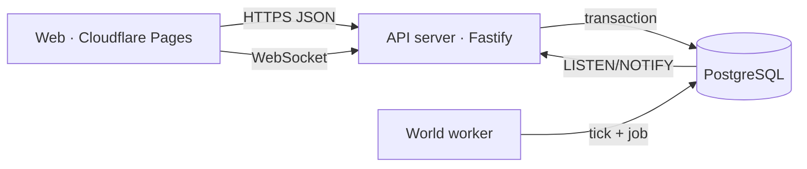

# Kiến trúc

## Tổng quan

- **Backend là nguồn sự thật duy nhất.** Client chỉ gửi *ý định* ("mua 120 kg bột mì, chấp nhận giá tối đa X"). Server tự đọc giá niêm yết, kiểm tra quyền, khóa dòng dữ liệu, tính kết quả và ghi sổ.
- **Mọi thao tác ghi đều nằm trong transaction.** Lỗi deadlock hoặc serialization được tự động thử lại.
- **Idempotency:** mỗi thao tác của người chơi mang header `Idempotency-Key`. Bút toán có khóa duy nhất, nên bấm hai lần hoặc gửi lại sau khi rớt mạng vẫn chỉ được ghi một lần. Client còn khóa nút ngay từ lần bấm đầu.

## Đồng hồ và job

- Giờ game luôn được *tính* từ `world_config.epoch`, không lưu "ngày hiện tại", nên API, worker và trình duyệt thấy cùng một giờ.
- Thế giới tiến theo **tick 30 phút game** (1 phút thực). Worker ghi một dòng `world_ticks(tick)` (khóa chính) và đẩy job cho tick đó *trong cùng transaction*.
- Mỗi job có `dedupe_key` duy nhất. Hiệu ứng nghiệp vụ và việc đánh dấu `done` được commit cùng nhau, nên mỗi job chạy đúng một lần kể cả khi worker sập giữa chừng.
- Khởi động lại sau thời gian ngừng: worker bù lần lượt mọi tick bị lỡ, theo thứ tự, mỗi tick một lần. Job mang `game_minute` của tick gốc, nên lương, doanh thu và lãi được tính đúng thời điểm.
- Job theo tick: làm việc theo ca và tiến độ sản xuất (`company.tick`), thị trường bán lẻ (`market.tick`), giao hàng đến ETA (`shipment.deliver`).
- Job hằng ngày (00:00 giờ game): trả lương, chi phí vận hành, lãi vay, thu nhập dân cư, bổ sung lao động.
- Job hằng tháng (mỗi 7 ngày game): chốt báo cáo tài chính, thuế, xét giai đoạn phát triển, xét danh hiệu Yêu Thích.
- Chu kỳ Reviewer dùng **thời gian thực** (`now()` của database), chạy mỗi 10 phút.
- Chưa dùng Redis: hàng đợi job dùng PostgreSQL (`FOR UPDATE SKIP LOCKED`), realtime dùng `LISTEN/NOTIFY`. Như vậy việc đưa job vào hàng đợi và ghi dữ liệu nằm chung một transaction, ít thành phần phải vận hành hơn. Khi cần nhiều instance API, sẽ thêm Redis cho rate limit và fan-out WebSocket.

## Sổ cái kép

- Bảng `accounts` (chủ thể × mã tài khoản), `journal_entries` (khóa idempotency duy nhất) và `postings` (số tiền có dấu, nợ dương).
- Ba lớp bảo vệ:
  1. Trigger hoãn đến lúc commit, kiểm tra mỗi bút toán có tổng bằng 0.
  2. Code kiểm tra **từng chủ thể** (người chơi, doanh nghiệp, ngân hàng…) cũng cân bằng, nên sổ riêng của mỗi doanh nghiệp luôn khớp và lập được bảng cân đối thật.
  3. `CHECK (NOT no_overdraft OR balance >= 0)` trên các tài khoản tiền và hàng: database từ chối chi quá số dư, kể cả khi có hai request đồng thời.
- `postings` và `journal_entries` chỉ được thêm, không được sửa hay xóa (trigger chặn).
- Giá trị tồn kho trong bảng `inventory` luôn bằng số dư tài khoản `inventory` trên sổ cái (có test kiểm chứng).

### Nguồn tiền và nơi tiền đi (minh bạch)

| Nguồn phát hành (ngân hàng trung ương) | Ghi chú |
|---|---|
| Vốn khởi nghiệp người chơi mới | 600 triệu ₫/người, một lần |
| Vốn điều lệ ngân hàng thương mại | 400 tỷ ₫, lúc khởi tạo thế giới |
| Vốn đầu tư vào doanh nghiệp NPC | Lúc khởi tạo |
| Trợ cấp dân cư hằng ngày | 600 triệu ₫ + 25 triệu ₫ × số doanh nghiệp đang hoạt động |

Dòng tiền khép kín:
- Lương, tiền thuê mặt bằng, cước vận chuyển, quảng cáo, bảo trì và thiết bị chảy về **khu vực dân cư**.
- Dân cư mua hàng tiêu dùng.
- Thuế và lệ phí vào **ngân sách nhà nước**, cuối mỗi ngày được chi lại cho dân cư.
- Lãi vay vào vốn ngân hàng.
- Công thức kiểm toán: tiền đang lưu thông luôn bằng tiền đã phát hành (xem `/economy` và Admin).

## Mô hình kinh tế

- **Sản xuất:**
  - Một công thức cần nguyên liệu (xuất kho ngay khi bắt đầu lệnh) và đúng loại máy (công suất giảm theo độ hao mòn).
  - Cần thêm giờ công của nhân viên phòng Sản xuất *đang trong ca*. Năng suất phụ thuộc kỹ năng và tinh thần. Thành phẩm vào kho dần theo từng mẻ.
- **Lịch làm việc:**
  - Ca ngày: 08–12, nghỉ trưa 12–13, 13–17, Thứ Hai đến Thứ Sáu.
  - Ca đêm: 22–06. Bán thời gian: 17–21 (Thứ Hai đến Thứ Bảy). Ca xoay: 06–14, cả 7 ngày.
- **Bán lẻ:**
  - Mỗi tick, dân cư chi một phần tiền mặt (ban ngày nhiều hơn ban đêm).
  - Ngân sách mỗi mặt hàng chia cho các cửa hàng đang mở cửa, có hàng và có nhân viên bán hàng trong ca, theo sức hút: `(giá tham chiếu / giá)^độ co giãn × uy tín × thương hiệu × lưu lượng khách tại vị trí`.
  - Luôn có một "lựa chọn khác" để giá quá cao làm mất khách.
  - Lượng bán bị giới hạn bởi tồn kho và số khách nhân viên phục vụ được.
- **Bán buôn:** giá do bên bán niêm yết. Hàng rời kho bên bán ngay, đi đường theo ETA (khoảng 15% lô hàng bị trễ, được thông báo).
- **Marketing:** trả tiền trước, có độ trễ theo kênh, hiệu quả giảm dần theo căn bậc hai, thương hiệu suy giảm 4%/ngày.
- **Ngân hàng:**
  - Cho vay từ nguồn vốn hữu hạn. Hạn mức của doanh nghiệp là 2× vốn chủ sở hữu.
  - Lãi 0,35%/ngày game. Mỗi 7 ngày trả gốc và lãi. Trễ hạn tính lãi phạt; trễ 3 kỳ là nợ xấu.
- **Phá sản:** không trả được lương, tiền thuê, thuế hoặc nợ trong 7 ngày liên tiếp thì doanh nghiệp phá sản. Nhân viên được giải phóng, lệnh chứng khoán bị hủy, mã bị tạm ngừng giao dịch.
- **Chứng khoán:**
  - IPO chỉ là một lệnh bán thật. Sổ lệnh khớp theo giá rồi thời gian; lệnh có thể khớp một phần.
  - Lệnh thị trường chỉ lấy thanh khoản đang có (không có người bán thì bị từ chối).
  - Tiền và cổ phiếu bị phong tỏa khi đặt lệnh. Có biên độ ±30%, lô 10 cổ phiếu, bước giá 100 ₫.
  - Chặn tự khớp lệnh của chính mình. Doanh nghiệp không tự giao dịch cổ phiếu của mình.
- **NPC:** dùng chung đúng các hàm của người chơi (tuyển dụng, mua hàng, sản xuất, niêm yết giá), với ngân sách hữu hạn được bảo vệ bởi sổ cái.

## Bảo mật

- Mật khẩu băm bằng scrypt.
- Token phiên: chuỗi ngẫu nhiên 256 bit, chỉ lưu bản băm SHA-256. Có thể thu hồi (khóa tài khoản là thu hồi ngay mọi phiên).
- Mọi input đều qua zod. Rate limit chung 300 request/phút/IP; đăng ký và đăng nhập 10 request/phút.
- Có Helmet, CORS theo danh sách được phép, giới hạn kích thước body 64 KB.
- Mọi route Admin kiểm tra quyền ở server. Thao tác nhạy cảm bắt buộc có lý do và được ghi `audit_log`.
- Không có tài khoản Admin mặc định: phải tạo bằng CLI với mật khẩu từ 14 ký tự do người vận hành nhập.
- Không có secret nào trong repository.
